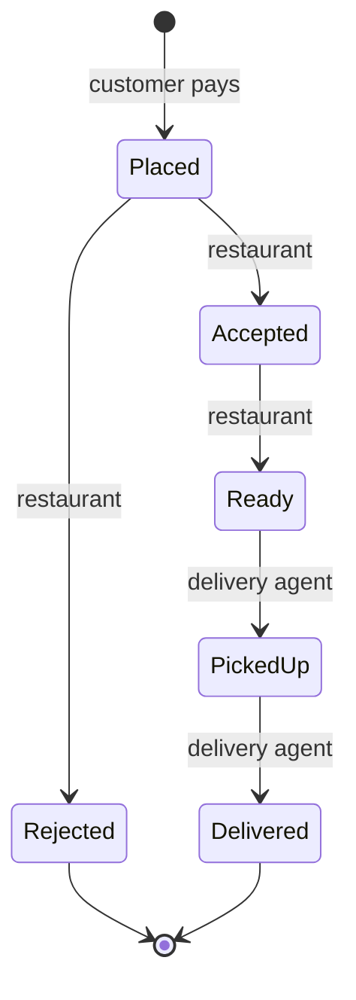

# Minimum Viable Product

**Version:** 1.0 · **Date:** 2026-11-11

The MVP is the first version of MTOGO that is deployed and used end to end: a customer places and pays for an order, the restaurant prepares it, a delivery agent delivers it, and the customer follows it the whole way. Everything else in the case builds on the data this flow creates. The case itself is the project description from the course.

The MVP is tracked by the MVP epic (backend #28) and the **MVP** milestone on the [project board](https://github.com/orgs/Kanban4sem/projects/1). Each slice is one issue in `MTOGO-Backend` and one in `MTOGO-Frontend`, linked to each other. The backend issue owns the API contract. This document has a copy in both repositories.

## Slices

| #   | Slice                      | Backend | Frontend | Done when                                                                                               |
| --- | -------------------------- | ------- | -------- | ------------------------------------------------------------------------------------------------------- |
| 1   | Customer account           | #13     | #6       | A customer can register, log in and log out. Restaurant and delivery-agent users are seeded with a role |
| 2   | Restaurants and menus      | #14     | #7       | A customer can see the restaurants that accept orders, and each restaurant's menu items and prices      |
| 3   | Place and pay for an order | #15     | #8       | A customer can order menu items to a delivery address and pay through the mocked payment service        |
| 4   | Restaurant handles orders  | #16     | #9       | A restaurant can accept or reject its new orders and mark accepted orders as ready                      |
| 5   | Delivery                   | #17     | #10      | A delivery agent can take a ready order, mark it as picked up and then as delivered                     |
| 6   | Order tracking             | #18     | #11      | A customer can see the current status of their orders                                                   |

Slices 1 and 2 can be built in parallel. Slice 3 needs both. Slices 4–6 need slice 3.

## Decisions

- **Accounts.** Customers create their own accounts. Restaurants, their menus and delivery agents are seeded through Flyway. Every user has exactly one role: customer, restaurant or delivery agent.
- **Payment.** The payment provider is mocked behind an interface, so a real provider can replace it without changing the order flow. An order is placed only when the payment is confirmed. A declined payment creates no order.
- **Order channel.** The case lists website, app and telephone. The MVP orders through the website only, but every order records its channel, so the dashboard can report on channels later.
- **Deployment.** The MVP is done when it runs on stage, not when it runs locally. The server is set up in backend #11, and `main` is deployed to it by the deploy pipeline (backend #20, frontend #13). Both are in the MVP milestone.

## Order status lifecycle

An order moves through these statuses. Each status names who moves it on.

| Status    | Meaning                                                   | Set by         |
| --------- | --------------------------------------------------------- | -------------- |
| Placed    | Paid and waiting for the restaurant                       | Customer       |
| Accepted  | The restaurant is preparing the food                      | Restaurant     |
| Rejected  | The restaurant will not prepare the order. Final status   | Restaurant     |
| Ready     | The food is ready to be collected                         | Restaurant     |
| PickedUp  | A delivery agent has collected the food and is on the way | Delivery agent |
| Delivered | The customer has received the food. Final status          | Delivery agent |

Only these moves are allowed. Any other change is refused. Each status records when it was set, which the dashboard needs for processing times. Every status has a Danish and an English name, so the frontend can show either.

What happens to the payment when an order is rejected is not part of the MVP. The issue that adds refunds decides it.

## Not in the MVP

These are required by the case and follow the MVP, roughly in this order, since each one needs data from the one before:

1. **Commission and service fee** (backend #23). The sliding commission on the order value excluding VAT
2. **Feedback** (backend #24, frontend #15). Ratings for the food, the overall experience and the delivery agent after delivery
3. **Bonus** (backend #25). Bonuses for delivery agents, based on delivered orders, hours and ratings, and kept within MTOGO's revenue
4. **Management dashboard** (backend #26, frontend #16). Open orders, orders per 24 hours and average processing time
5. **Notifications and Danish** (backend #27, frontend #17 and #18). Status updates by SMS or in the app, and a Danish user interface

Also on the board after the MVP: customer details such as name, phone number and saved addresses (backend #22, frontend #14), and a coverage quality gate (backend #21).

**Complaints** are not part of the project. The MVP keeps them possible by keeping each feature in its own package, as described in the [coding standards](coding-standards.md#architecture), so complaints can be added as a new feature without changing existing ones.

## Changelog

How to change this document is described in [CONTRIBUTING](../CONTRIBUTING.md#changing-the-documents).

| Version | Date       | Change        | Issue |
| ------- | ---------- | ------------- | ----- |
| 1.0     | 2026-11-11 | First version | #12   |
